# Architecture (implemented scope)

This document describes what the code does **now**. Planned components are not
listed as if they exist; see `docs/milestones.md` for the roadmap.

## One flow

```mermaid
flowchart LR
  A[codecitadel scan] --> B[contracts: validate CLI input]
  B --> C[core: scanRepository]
  C --> D[scanner-client: resolve binary + spawn]
  D --> E[Rust scanner: discover]
  E --> F[bounded read + sha256 + binary/UTF-8 checks]
  F --> G[native text rules]
  G --> H[NDJSON records]
  H --> I[scanner-client: Zod validation + collection]
  I --> J[core: report assembly]
  I --> S[core: buildSnapshot]
  S --> T[(snapshot file, write-once)]
  T --> U[core: diffSnapshots]
  S --> U
  S --> V[symbol-graph: module graph]
  U --> W[impact: backwards reachability]
  V --> W
  W --> X[run: selected test files]
  X --> Y[executor: disposable copy + supervised Vitest]
  Y --> Z[captured JSON reporter payload]
  Z --> AA[executor: Zod validation + normalization]
  AA --> AB[(execution report)]
  AB --> AC[core: compareExecutionReports]
  AC --> AD[(execution comparison)]
  N[(requirements document)] --> AO[core: evaluateRequirements]
  AB --> AO
  AO --> AP[(requirements evaluation)]
  U --> K{renderer}
  W --> K
  J --> K
  K --> L[JSON / Markdown / SARIF / diff / run / compare text]
```



Execution path in files:

1. `apps/cli/src/index.ts` builds the command tree, maps errors to exit codes.
2. `apps/cli/src/commands/scan.ts` validates flags and calls the engine.
3. `packages/core/src/engine.ts` resolves the root, calls the client, checks
   consistency, and hands data to `buildReport`.
4. `packages/scanner-client/src/client.ts` spawns the binary with an argument
   array and reads its stdout line by line.
5. `packages/scanner-client/src/stream.ts` validates every record against the
   contract before it can influence a report.
6. `crates/scanner-core/src/scan.rs` walks files, reads bytes with limits, hashes
   them, runs rules, and streams records.
7. `packages/core/src/report.ts` sorts, counts, and attaches limitations.
8. `packages/core/src/snapshot.ts` turns one scan into a snapshot and compares
   two snapshots into a diff.
9. `packages/symbol-graph/src/graph.ts` parses the scanned modules with the
   TypeScript compiler API and resolves local imports into a graph;
   `impact.ts` walks it backwards from the changes.
10. `apps/cli/src/analyze.ts` is the shared change-analysis pipeline
    (scan → snapshot → diff → graph → impact); `impact` and `run` both call it so
    the selected tests and the executed tests cannot diverge.
11. `apps/cli/src/commands/run.ts` passes the selection to
    `packages/executor`: `copy.ts` creates the working directory, `process.ts`
    supervises the runner, `vitest-report.ts` validates and normalizes the
    payload, and `vitest.ts` (`executeTests`) sequences them; the CLI assembles
    and validates the execution report.
12. `apps/cli/src/commands/compare.ts` reads two stored execution reports and
    hands them to `packages/core/src/compare-execution.ts`, which pairs their
    per-test results by fingerprint and labels every pair.
13. `apps/cli/src/commands/requirements.ts` reads (or accepts, or checks) a
    declarative requirement document; `packages/core/src/requirements.ts`
    parses it, recomputes each acceptance digest, and evaluates the registered
    checks against a stored execution report.
14. `apps/cli/src/commands/patch.ts` parses an untrusted unified diff with
    `packages/executor/src/diff-parse.ts`, applies it only inside a disposable
    copy through `packages/executor/src/patch.ts` (strict paths, exact context
    matching), re-executes the before report's
    selected tests there, and lets `packages/core/src/patch-verification.ts`
    (`inspectPatch`, `decidePatchVerdict`) choose the verdict from the
    comparison, the requirement evaluation, and the weakening signals.
15. `apps/cli/src/commands/reproduce.ts` reads a declared reproduction, checks
    its requirement's acceptance, executes that one test file in a disposable
    copy, and lets `packages/core/src/reproduction.ts`
    (`decideReproductionVerdict`) classify the named result; the export
    subcommand writes the recorded source and a provenance manifest instead of
    executing anything.
16. `apps/cli/src/render.ts` renders Markdown, diff, impact, run, and comparison
    output, `render-requirements.ts` renders requirement summaries and
    evaluations, `render-patch.ts` renders a patch verification, and
    `render-reproduction.ts` renders a reproduction or an export;
    JSON is the report, the diff, the impact report, the execution report, the
    comparison, the requirement records, the patch verification, the
    reproduction, or the export manifest itself.

Error path: a missing root produces `error` + `done` records from Rust and exit
code 2; the client turns that into `ScannerRunError`; the CLI prints
`codecitadel: …` to stderr and exits 2. A scanner that dies without `done` is a
`ScannerProtocolError`, never an empty result.

## Boundaries

**Rust owns** discovery, ignore evaluation, content digests, binary detection,
and bounded text matching. It never parses project configuration, installs
anything, or runs repository programs.

**TypeScript owns** contracts, orchestration, report assembly, rendering, and CLI
semantics. It does not re-implement Rust rules, and it does not "repair" scanner
output.

**Contracts own** the wire and storage shapes. Both the scanner (via serde) and
the client (via Zod) are tested against one captured record,
`fixtures/analysis/scanner-hello.ndjson`.

## Invariants

- A findings report is only produced after a `done` record whose exit code
  matches the process exit code.
- `summary.findings` must equal the number of received findings, or the engine
  throws.
- Unknown rule IDs are a hard error, not a silently narrower scan.
- The options recorded in the report are the ones the scanner echoed, not the
  ones the client requested.
- Every report carries at least one limitation.
- Finding fingerprints are derived from rule ID, path, and matched text — not
  line numbers — so unrelated insertions do not change them.
- Text positions: UTF-8 byte offsets from Rust, converted to 1-based lines and
  UTF-16 columns for editors. Documented on both sides.
- Secrets are redacted before serialization. A test asserts the raw example key
  never appears in scanner output, the report, or Markdown.

## Distribution

The scanner ships as a prebuilt binary inside a per-platform npm package
(`npm/scanner-<platform>-<arch>`), and the CLI lists those packages as
`optionalDependencies`. `resolveScannerBinary` checks, in order: `--scanner`, the
`CODECITADEL_SCANNER_BIN` override, the installed platform package, and finally a
Cargo build above the working directory. `PATH` is never consulted.

A platform package carries `binary.json` with the binary's SHA-256. The client
re-hashes the binary on every launch and refuses to execute it on a mismatch; it
does not fall back after a failed check. `node scripts/package-scanner.mjs`
produces the artifact for the host target only, and
`node scripts/verify-pack.mjs` proves the whole release shape by packing every
package, installing the tarballs into an empty directory outside the repository,
and scanning there with no Cargo build and no environment overrides. Rationale
and cost: [ADR 0004](adr/0004-prebuilt-binary-distribution.md).

## Snapshots and change diffs

What changed is a claim that needs evidence, so a comparison stores its baseline.

1. `scan --save-snapshot <file>` builds a snapshot from the report **plus the
   scanner's per-file records** (`scanRepositoryDetailed`). The report keeps only
   findings; the snapshot needs every path, digest, and skip reason it saw.
2. Snapshot files are written with the `wx` flag. Rewriting a snapshot is
   refused, because a baseline someone else's comparison depends on is not a
   cache.
3. `diff --base <file>` re-scans the head tree, builds a head snapshot in memory,
   and compares content digests and finding fingerprints
   (`packages/core/src/snapshot.ts`).

The comparison classes are chosen so uncertainty has a name:

| Situation | File bucket | Finding bucket |
| --- | --- | --- |
| digest in both, equal | `unchanged` | `carriedOver` |
| digest in both, different | `modified` | compared by fingerprint |
| digest only in head | `added` | `introduced` |
| digest only in base, head not truncated | `removed` | `resolved` |
| digest only in base, head truncated | `unverified` | `unverified` |
| head record has no digest (too large, unreadable) | `unverified` | `unverified` |
| head record skipped as binary/non-UTF-8 | file change is still known | `unverified` |

A file that was skipped for being binary carries a digest but was never analyzed,
so a finding that disappears from it is `unverified`, never `resolved`. The diff
also reports differing enabled rules and differing coverage options, because
those change results without the code changing.

## Impact analysis

`impact` answers "which tests can see this change" without running anything.

1. The head tree is scanned and diffed against a stored snapshot, producing the
   changed file list (added, modified, removed, unverified).
2. `buildModuleGraph` parses those same scanned files with
   `ts.createSourceFile` and collects `import`, `export … from`, `require`, and
   `import()` specifiers. Local specifiers are resolved with
   `ts.resolveModuleName`; bare specifiers are counted and not followed.
3. `computeImpact` walks the reverse edges breadth-first from every change, so a
   test's chain is the shortest explanation available, and reports selected
   tests, non-selected tests, and every reason the graph might be incomplete.

Three honesty rules are structural, not documentation:

- A local import that does not resolve is recorded in `unresolved` and forces
  `complete: false`. Dropping the edge would silently shrink the selection.
- A source file the scanner skipped (binary, too large) is not parsed; it is
  listed with its skip reason and forces `complete: false`.
- A changed file that is not in the graph forces `complete: false` with the file
  named, unless it was removed and nothing analyzed imported it.

`complete: false` means the selection is a lower bound. The impact report carries
at least three limitations, including that a non-selected test is not proven safe
and that no test was executed.

## Reports

One report contract feeds every renderer. JSON is the report itself; Markdown and
SARIF are generated from it in `apps/cli/src/render.ts` and
`apps/cli/src/sarif.ts`. Neither renderer recomputes analysis, and both are tested
for the redaction guarantee: the example secret must never appear in output.

SARIF cannot express everything the report knows, so the renderer translates
rather than flattens: five severities map onto three levels (`critical`/`high` →
`error`, `medium` → `warning`, `low`/`info` → `note`) while the original severity,
confidence, and evidence status travel in result properties. A redacted snippet
is omitted instead of being written as the literal `[redacted]`, and the SARIF
schema subset is validated (`sarifLogSchema`) before the document is printed.

## Test execution

`run` is the only command that executes repository code, and it says so in its
help text. The path is: stored baseline → fresh scan → diff → module graph →
selected test files → executor.

The executor (`packages/executor`) does four things:

1. **Resolve the runner.** `--runner`, then `<root>/node_modules/vitest/vitest.mjs`,
   then each ancestor of the root. `PATH` is never consulted; an explicit path
   that does not exist is an error rather than a reason to search elsewhere.
2. **Prepare a disposable working directory.** The source tree is copied into the
   OS temp directory, skipping VCS, build output, and dependency directories.
   Every skipped `node_modules` is re-created as a directory link, so imports
   resolve without an install. The copy is bounded (20 000 files / 256 MB) and
   removed afterwards.
3. **Supervise one process.** `node vitest.mjs run --reporter=json
   --outputFile=<tmp> --no-color <files>` with an argument array, no shell, a
   deadline (SIGTERM, then SIGKILL after 5 s), cancellation through an
   `AbortSignal`, a bounded shared output budget, and an allow-listed environment
   so tokens and `NODE_OPTIONS` are not inherited.
4. **Normalize.** The reporter payload is validated with Zod and mapped to one
   result per test with a stable `t_…` fingerprint over file and full test name.

Outcomes are separated on purpose:

| Observed | Reported |
| --- | --- |
| every selected test passed | `passed` |
| at least one test failed | `failed` |
| deadline reached / caller cancelled | `timed_out` / `cancelled` |
| collection error, crash, unreadable or missing report, selected file with no result | `errored` |
| Vitest cannot be resolved | `unsupported` |
| nothing selected | `skipped`, `command: []` |

The execution report embeds the impact report, so it states which tests were
selected, why, and what was out of scope. It never claims a passing run proves
the change correct, and `node_modules` sharing, the missing sandbox, and skipped
symlinks are listed as limitations rather than hidden. Rationale:
[ADR 0005](adr/0005-isolated-test-execution.md).

## Before/after comparison

One run is a claim about one tree. `compare` answers the relational question —
did the failure go away, and did anything else change — by reading two stored
run reports (`run --out` outputs) and interpreting them:

1. `apps/cli/src/commands/compare.ts` strict-reads both files (schema version
   checked, no directory access, nothing executed).
2. `packages/core/src/compare-execution.ts` pairs results by `t_…` fingerprint
   and labels each pair from the after side's point of view.
3. The verdict is a versioned record (`executionComparisonSchema`): counts per
   label, one entry per fingerprint, and the reasons the pair must not be read
   as evidence when it is not comparable.

| Pair of statuses | Label |
| --- | --- |
| failed → failed | `still_failing` |
| passed → failed | `newly_failing` |
| failed → passed | `fixed` |
| passed → passed | `still_passing` |
| absent → passed | `newly_passing` |
| same inconclusive status → unchanged | `still_inconclusive` |
| anything → inconclusive | `newly_inconclusive` |
| skipped → skipped | `still_skipped` |
| anything → skipped | `newly_skipped` |
| present → absent | `gone` |

The pair is marked `not comparable`, with reasons in the record and on stderr,
when roots, platforms, Node versions, runner versions, isolation modes, selected
files, or change classifications differ. A fingerprint that survives is still
flagged `identitySuspect` when its file's change classification differs between
the two runs: the id covers file + name, not the test body. Rationale and
limits: [ADR 0006](adr/0006-execution-comparison.md).

Exit codes: `0` comparable and no failing after side, `1` any after-side failure
(newly or still), `2` not comparable or evidence lost — the same rule `run`
uses: inconclusive is an error, never a pass.

## Accepted requirements

Tests describe what happened. A **requirement** describes what was supposed to
happen, in a committed document (`codecitadel.requirements.json`) that names the
checks that would count as evidence:

```json
{ "id": "coupon.single-redemption",
  "statement": "A coupon can be redeemed only once per user.",
  "state": "accepted",
  "checks": [{ "id": "coupon-repeated-use", "file": "src/coupon.test.ts",
               "name": "coupon > a repeated redemption is rejected" }],
  "acceptance": { "acceptedAt": "…", "acceptedBy": "…", "digest": "sha256:…" } }
```

1. `packages/contracts/src/requirements.ts` defines the versioned document. The
   schema is strict: an unknown field is a load error, not a silently ignored
   typo, and it is also what lets the accept command rewrite the file without
   losing anything.
2. Acceptance is a separate, explicit act (`requirements accept <id> --by
   <name>`). It writes a digest over the canonical `{ id, statement, checks }`.
   Nothing else — not a passing test, not a model — can set the state.
3. Every read recomputes that digest. If the statement or a check changed after
   acceptance, the requirement is `stale`: `list` exits 2 and `check` gives it
   `not_accepted`.
4. `requirements check --report <run.json>` computes each check's `t_…`
   fingerprint from `file + name` and looks it up in the stored results. A
   missing result is `not_run`; a skipped, timed-out, errored, cancelled, or
   unsupported result is `inconclusive`.
5. Verdicts are `met`, `unmet`, `inconclusive`, and `not_accepted`. A proposed
   or rejected requirement is never met, even when its tests pass.

Exit codes: `0` every accepted requirement met, `1` any unmet, `2` any
inconclusive or stale acceptance. Unaccepted requirements are reported on
stderr and do not affect the exit code. Rationale: [ADR 0007](adr/0007-accepted-requirements.md).

## Patch verification

A patch is a claim the project has not yet seen executed. `patch verify` asks
whether the stored evidence survives applying it — and whether the patch plays
fair with that evidence:

1. `apps/cli/src/commands/patch.ts` reads the before report (strict schema), so
   the analyzed root and the test selection come from stored evidence, not from
   the patch.
2. `packages/executor/src/diff-parse.ts` parses the diff: no `git` binary, no shell,
   and a refusal with a reason for absolute, `..`, backslash, or quoted paths,
   VCS internals, binary changes, renames, and file-mode changes.
3. `createSourceCopy` + `applyPatch` write only inside a disposable copy; every
   ancestor is lstat-checked so a symlink cannot redirect a write. Context
   matching is exact — no fuzz — so a patch from another tree is `not_applied`
   before anything runs.
4. `executeTests` re-runs exactly the before report's selected files in the
   patched copy through the Vitest adapter `run` uses. Tests the patch adds are
   never run, and the report says so; otherwise the patch would pick its own
   audience.
5. `packages/core/src/patch-verification.ts` decides in a fixed order:
   `not_applied` → weakening signals → requirement regressions → inconclusive
   statuses → incomparable pairing → newly/still failing → newly inconclusive /
   newly skipped / gone → `verified` only when every compared result passed.
   `inspectPatch` classifies each touched file (source, test, runner
   configuration, lockfile, requirement document, ignore rules) and scans added
   lines for skipped/focused tests and suppressed diagnostics; removed
   assertions are counted against added ones.
6. The report is versioned (`PATCH_VERIFICATION_SCHEMA_VERSION`) and carries the
   patch digest, the inspection, the before/after pairing, the requirement
   evaluation, the requirement regressions, the full after run, and mandatory
   limitations.

Exit codes: `0` verified, `1` not verified, `2` not applied or inconclusive.
Rationale and limits: [ADR 0008](adr/0008-patch-verification.md).

## Reproduction and export

A reproduction is a claim with a check attached: "this expected behavior does
not hold here, and this test shows it". The manifest owns the claim; the run owns
the evidence:

1. `apps/cli/src/commands/reproduce.ts` reads the manifest through
   `parseReproductionDocument` (strict v1, unknown fields rejected) and selects
   one entry by id.
2. `readCheckSource` validates the relative path (`validateReproductionPath`:
   no absolute paths, drive letters, backslashes, or `.`/`..`), refuses a
   symlink or a file outside the root, bounds the bytes, and digests the text.
3. `readRequirementState` resolves the linked requirement to
   `{ state, acceptance }`; a missing document or id is `missing`, never
   approval.
4. When the gate is open, `executeTests` runs that single file in the same
   disposable copy `run` uses, and `testFingerprint(file, test)` picks the named
   result out of the normalized list.
5. `decideReproductionVerdict` decides in a fixed order: requirement gate →
   nothing executed → run status not `passed`/`failed` → no result for the named
   test → `failed` is `reproduced`, `passed` is `not_reproduced`, everything
   else `inconclusive`.
6. The report carries the check's source, digest, and byte count, so
   `reproduce export` needs no tree: it verifies digest and size, refuses the
   three dangerous destinations (outside `--out`, inside the analyzed root
   without `--in-root`, an existing file without `--force`), and writes the test
   at its original relative path plus `<id>.reproduction.json`.

Exit codes: `0` reproduced, `1` not reproduced, `2` inconclusive or not
accepted. Rationale and limits: [ADR 0009](adr/0009-reproduction-and-regression-export.md).

## Determinism

File order is sorted by relative path in Rust. Findings are sorted by path,
line, column, rule ID, then fingerprint. Durations and timestamps are recorded
but never feed ordering. Two runs over unchanged input produce identical
findings, and an end-to-end test asserts it.

## What is not here

No type-checking or TypeScript program construction, no `tsconfig` path-alias
resolution, no symbol-level narrowing (which export changed, which importer uses
it), no generated reproduction, no evidence replay, no mutation testing, and no
patch proposal or apply action. A reproduction is a check the operator declares
and a single run of it: it is not stored history, it does not repeat for
flakiness, and the exported test is their code unchanged. Patch verification
exists (`patch verify`) but it verifies a patch against a stored run, not against
a reproduction; the before/
after pairing still works on self-reported stored reports: it does not verify
that a report was actually produced by the runner it names, and no test-body
digest closes the same-name-editing hole. Execution exists for selected Vitest
files only: no Jest adapter, no container isolation, and no run storage beyond
the report file. There is no persistence beyond snapshot and report files, no
server, no dashboard, and no AI provider. Those are roadmap items with gates,
not partially built features.

Distribution exists but is not published: the packages are `private: true`, no
registry namespace or name-conflict check has been done, and only the Windows x64
artifact has been built. See `docs/support-matrix.md`.
